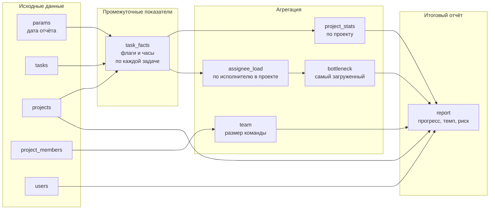

# Лабораторная работа №2. Вариант 11 — Система управления проектами

SQL-запросы и аналитические сценарии на модели данных из ЛР №1
(`users`, `projects`, `project_members`, `tasks`, `comments`).

## Состав работы

| Файл | Содержимое | Задание |
|---|---|---|
| `migration.sql` | расширение модели: `tasks.estimate_hours`, `tasks.completed_at` | — |
| `data.sql` | дополнение данных до 122 записей | 1.1 |
| `dml.sql` | INSERT / UPDATE / массовый UPDATE / DELETE / ROLLBACK | 1.2 |
| `queries.sql` | 6 операционных запросов + 4 запроса с подзапросами | 2.1, 2.2, 3.1–3.4 |
| `report.sql` | аналитический отчёт на CTE | 4 |

Порядок запуска (на чистой базе):

```bash
createdb project_db
psql -d project_db -f ../Lab1/schema.sql
psql -d project_db -f ../Lab1/data.sql
psql -d project_db -f migration.sql
psql -d project_db -f data.sql
psql -d project_db -f dml.sql        # первая команда падает с ошибкой — так задумано
psql -d project_db -f queries.sql
psql -d project_db -f report.sql
```

Просроченность считается относительно `CURRENT_DATE`, поэтому результаты ниже получены
**30.10.2026** после выполнения `dml.sql`. В другой день часть чисел будет другой
(например, задача со сроком 01.11 станет просроченной) — это ожидаемо.

---

## Расширение модели (`migration.sql`)

Задание разрешает добавлять атрибуты, если они нужны для аналитики. Добавлены два столбца в
`tasks`:

| Столбец | Тип | Зачем | NULL означает |
|---|---|---|---|
| `estimate_hours` | `NUMERIC(5,1)` | плановая трудоёмкость. Без неё у задач нет числового показателя (кроме приоритета) — нечего суммировать и усреднять: объём проекта, нагрузка исполнителя, прогресс в часах | задача ещё не оценена |
| `completed_at` | `TIMESTAMP` | момент фактического завершения. Без него нельзя проверить, сдана ли задача в срок, и посчитать время выполнения | задача не завершена |

Ограничения:

- `chk_tasks_estimate` — `estimate_hours >= 0` (0 допустим: работа на несколько минут);
- `chk_tasks_completed` — `(status = 'done') = (completed_at IS NOT NULL)`: дата завершения есть
  тогда и только тогда, когда задача выполнена;
- `chk_tasks_completed_after_created` — завершение не раньше создания.

Существующие данные сохранены: столбцы добавляются без ограничений → 8 задач из ЛР №1
получают значения (`UPDATE ... FROM (VALUES ...)`, поиск по паре «проект + название») → только
после этого добавляются `CHECK`. Заодно уточнён `created_at` этих задач: в ЛР №1 там момент
загрузки скрипта, и иначе задачи завершённого в июне проекта оказались бы созданными в октябре.

---

## Часть 1. Данные и DML

### 1.1. Набор данных (`data.sql`)

Записи ЛР №1 не удаляются, только дополняются. id новых строк не пишутся руками — ссылки
ищутся по уникальным полям (email, название проекта, проект + название задачи) через
`INSERT ... SELECT ... FROM (VALUES ...) JOIN ...`.

| Таблица | Было | Стало |
|---|---|---|
| `users` | 6 | 14 |
| `projects` | 3 | 7 |
| `project_members` | 9 | 26 |
| `tasks` | 8 | **43** (основная операционная) |
| `comments` | 6 | 32 |
| **итого** | 32 | **122** |

| Требование | Как выполнено |
|---|---|
| ≥ 100 записей, ≥ 30 в операционной таблице | 122, из них 43 задачи |
| ≥ 3 состояний процесса | задачи: `todo`, `in_progress`, `review`, `done`; проекты: `planned`, `active`, `completed`, `cancelled` |
| ≥ 3 календарных месяцев | задачи созданы с марта по октябрь 2026 |
| повторяющиеся операции у одной сущности | у Сидорова 7 задач в трёх проектах; у задачи «Подключить онлайн-оплату» 4 комментария |
| сущности без операций | Волкова и Григорьева не в проектах; у «Чат-бот поддержки» нет задач; у части задач нет комментариев; Морозова — участник «Мобильного приложения» без задач в нём |
| пограничные значения и NULL | оценка 0 ч («Обновить ссылки в футере»); `estimate_hours`, `assignee_id`, `due_date`, `end_date`, `description` = NULL; задачи, сданные позже срока; просроченные незавершённые задачи; незавершённые задачи в отменённом проекте |

### 1.2. Операции изменения (`dml.sql`)

| № | Операция | Что делает |
|---|---|---|
| 4а | `DELETE` (ошибка) | удаление Петровой падает: она владеет проектами, `projects.owner_id → users ON DELETE RESTRICT`. Выполняется **вне** транзакции, чтобы ошибка не прервала остальной сценарий |
| 1 | `INSERT` | новый проект «Бронирование переговорных» + 3 участника + 3 задачи. id проекта находится по уникальному названию; у задач не указаны `status` и `created_at` — срабатывают `DEFAULT` |
| 2 | `UPDATE` | «Фильтры каталога» проходят ревью: `review → done`. `status` и `completed_at` меняются **одним** UPDATE — иначе нарушится `chk_tasks_completed` |
| 3 | массовый `UPDATE` | эскалация: незавершённым просроченным задачам активных проектов приоритет повышается на 1 (`GREATEST(priority - 1, 1)`). Изменено 3 задачи |
| 4 | `DELETE` | в отменённом проекте удаляются задачи, к которым не приступали (`todo`). Комментарий к удалённой задаче удаляется каскадно (`comments.task_id ON DELETE CASCADE`) |
| 5 | `ROLLBACK` | ошибочное удаление проекта «Корпоративный сайт»: каскадом уходят 6 задач, 5 комментариев, 3 участника (45/31/29 → 39/26/26). После `ROLLBACK` счётчики возвращаются, проект на месте |

Пункты 1–4 выполняются в одной транзакции и фиксируются `COMMIT`.

---

## Часть 2. Операционная информация (`queries.sql`)

### 2.1.1. Подробная информация о задачах — 5 таблиц, LEFT JOIN

**Вопрос:** что происходит в незавершённых задачах активных проектов — кто исполнитель и в
какой роли, кто владелец проекта, сколько обсуждений, не просрочен ли срок?

`tasks` + `projects` + `users` (дважды: владелец и исполнитель) + `project_members` (роль) +
`comments` (количество). Исполнителя, роли и комментариев может не быть → `LEFT JOIN`,
`COALESCE(..., '— не назначена —')`, `count(c.comment_id)` даёт 0.

Результат — 17 строк, фрагмент:

| project | task | status | priority | assignee | assignee_role | due_date | deadline_state | comments |
|---|---|---|---|---|---|---|---|---|
| Интернет-магазин | Подключить онлайн-оплату | in_progress | 1 | Николаев Дмитрий | developer | 2026-10-10 | просрочена | 4 |
| Интернет-магазин | Интеграция со службой доставки | todo | 1 | — не назначена — | | 2026-12-01 | в срок | 0 |
| Мобильное приложение | Сверстать экран входа | in_progress | 1 | Сидоров Пётр | developer | 2026-10-15 | просрочена | 2 |
| Мобильное приложение | Настроить push-уведомления | todo | 4 | — не назначена — | | | нет срока | 0 |

### 2.1.2. Объекты без связанных записей — LEFT JOIN + IS NULL

**Вопрос:** кто из исполнителей действующих проектов не получил в своём проекте ни одной
задачи (незадействованный ресурс)? Менеджеры задач не исполняют — исключены.

`project_members` + `projects` + `users`, `LEFT JOIN tasks` по паре (проект, исполнитель),
`WHERE t.task_id IS NULL`.

| project | project_status | member | role | joined_at |
|---|---|---|---|---|
| Бронирование переговорных | planned | Захарова Юлия | tester | 2026-10-30 |
| Мобильное приложение | active | Морозова Светлана | tester | 2026-10-15 |

### 2.1.3. Несколько взаимосвязанных условий — задачи для эскалации

**Вопрос:** какие задачи нужно эскалировать менеджеру проекта?

Условия из разных таблиц: проект активен (`projects`) **и** задача не завершена, приоритет 1–2,
срок прошёл или наступит в ближайшие 7 дней (`tasks`) **и** у проекта есть менеджер
(`project_members` с `role = 'manager'` + `users`) — ему адресуется эскалация.

| project | manager | task | priority | due_date | days_left | assignee |
|---|---|---|---|---|---|---|
| Интернет-магазин | Петрова Анна | Подключить онлайн-оплату | 1 | 2026-10-10 | −20 | Николаев Дмитрий |
| Мобильное приложение | Иванов Иван | Сверстать экран входа | 1 | 2026-10-15 | −15 | Сидоров Пётр |
| Аналитическая платформа | Николаев Дмитрий | Настроить права доступа | 1 | 2026-10-20 | −10 | Лебедев Артём |
| Мобильное приложение | Иванов Иван | Написать тест-кейсы | 2 | 2026-10-20 | −10 | Кузнецова Мария |
| Аналитическая платформа | Николаев Дмитрий | Тест-план платформы | 2 | 2026-10-28 | −2 | Захарова Юлия |
| Мобильное приложение | Иванов Иван | Интеграция с платёжной системой | 1 | 2026-11-01 | 2 | Сидоров Пётр |
| Мобильное приложение | Иванов Иван | Экран каталога блюд | 2 | 2026-11-05 | 6 | Фёдоров Максим |
| Аналитическая платформа | Николаев Дмитрий | Разработать дашборд продаж | 2 | 2026-11-06 | 7 | Павлов Игорь |

### 2.2.1. Количественные показатели по группам

**Вопрос:** сколько задач в каждом проекте и на какой они стадии?

`GROUP BY` проекта, `count(...) FILTER (WHERE status = ...)` — по столбцу на статус.
`LEFT JOIN` + `count(t.task_id)` (не `count(*)`) — проект без задач показывается с нулями.

| project | project_status | total | todo | in_progress | review | done | unassigned |
|---|---|---|---|---|---|---|---|
| Интернет-магазин | active | 13 | 3 | 2 | 0 | 8 | 1 |
| Аналитическая платформа | active | 9 | 2 | 2 | 1 | 4 | 1 |
| Мобильное приложение | active | 9 | 4 | 2 | 1 | 2 | 1 |
| Корпоративный сайт | completed | 6 | 0 | 0 | 0 | 6 | 0 |
| Бронирование переговорных | planned | 3 | 3 | 0 | 0 | 0 | 1 |
| Внутренний портал | cancelled | 3 | 0 | 1 | 0 | 2 | 0 |
| CRM-система | planned | 2 | 2 | 0 | 0 | 0 | 1 |
| Чат-бот поддержки | planned | 0 | 0 | 0 | 0 | 0 | 0 |

### 2.2.2. SUM / AVG с фильтрацией групп через HAVING

**Вопрос:** кто из сотрудников перегружен — у кого больше 30 часов незавершённой работы?

Группировка по исполнителю, `SUM`, `AVG`, `MIN`, `COUNT(DISTINCT)`; `HAVING sum(...) > 30`.
`SUM`/`AVG` пропускают NULL, поэтому неоценённые задачи считаются отдельно
(`count(*) - count(estimate_hours)`): у таких сотрудников реальная нагрузка ещё больше.
Задачи отменённых проектов — не нагрузка, исключены.

| employee | open_tasks | projects | open_hours | avg_task_hours | not_estimated | nearest_due |
|---|---|---|---|---|---|---|
| Сидоров Пётр | 4 | 2 | 66.0 | 22.0 | 1 | 2026-10-15 |
| Павлов Игорь | 2 | 1 | 66.0 | 33.0 | 0 | 2026-11-06 |
| Николаев Дмитрий | 2 | 2 | 48.0 | 24.0 | 0 | 2026-10-10 |
| Фёдоров Максим | 2 | 1 | 34.0 | 17.0 | 0 | 2026-11-05 |

### 2.2.3. Сравнение временных периодов

**Вопрос:** как меняется поток задач по месяцам — сколько создано, сколько из них закрыто,
какой объём заложен, как быстро закрывали, сколько сдано с опозданием?

Группировка по `date_trunc('month', created_at)`; время выполнения —
`completed_at - created_at` в днях; `AVG`, `MIN`, `MAX` по нему (у незавершённых NULL — не учитываются).

| month | created | done | done_pct | planned_hours | avg_days | min_days | max_days | done_late |
|---|---|---|---|---|---|---|---|---|
| 2026-03 | 3 | 3 | 100 | 30.0 | 24.6 | 15.3 | 40.3 | 1 |
| 2026-04 | 2 | 2 | 100 | 6.0 | 22.1 | 0.1 | 44.2 | 1 |
| 2026-05 | 4 | 3 | 75 | 50.0 | 22.0 | 12.3 | 34.3 | 0 |
| 2026-07 | 4 | 4 | 100 | 74.0 | 21.3 | 12.3 | 29.4 | 1 |
| 2026-08 | 5 | 5 | 100 | 96.0 | 26.5 | 10.2 | 51.4 | 2 |
| 2026-09 | 14 | 4 | 29 | 256.0 | 16.7 | 1.1 | 45.3 | 1 |
| 2026-10 | 13 | 1 | 8 | 89.0 | 1.1 | 1.1 | 1.1 | 0 |

Вывод: с сентября поток задач вырос втрое (запуск двух новых проектов), а закрывается из них
меньше трети — команда не успевает за входящим объёмом. Июня нет: единственная июньская
задача удалена в `dml.sql` (п. 4).

---

## Часть 3. Подзапросы (`queries.sql`)

### 3.1. Сравнение со средним по группе

**Вопрос:** какие завершённые задачи выполнялись дольше, чем в среднем задачи **того же
проекта**? Группа — проект: у проектов разный темп, сравнивать со средним по компании
некорректно. Подзапрос в `FROM` один раз считает среднее время по каждому проекту.

| project | task | estimate_hours | lead_days | project_avg_days |
|---|---|---|---|---|
| Аналитическая платформа | Настроить ETL-процесс | 40.0 | 51.4 | 22.0 |
| Внутренний портал | Прототип главной страницы | 12.0 | 19.3 | 15.8 |
| Интернет-магазин | Фильтры каталога | 12.0 | 45.3 | 22.1 |
| Интернет-магазин | Сверстать каталог | 20.0 | 35.1 | 22.1 |
| Интернет-магазин | Реализовать корзину | 32.0 | 29.4 | 22.1 |
| Корпоративный сайт | Проверить адаптивность | 6.0 | 44.2 | 25.4 |
| Корпоративный сайт | Сверстать главную страницу | 20.0 | 40.3 | 25.4 |
| Корпоративный сайт | Провести нагрузочное тестирование | 10.0 | 34.3 | 25.4 |
| Мобильное приложение | Описать сценарии оплаты | 6.0 | 12.3 | 10.3 |

### 3.2. EXISTS

**Вопрос:** у кого из сотрудников есть **хотя бы одна** просроченная незавершённая задача в
активном проекте? Нужен только факт — `EXISTS` останавливается на первой найденной строке.

Результат: Захарова Юлия, Кузнецова Мария, Лебедев Артём, Николаев Дмитрий, Сидоров Пётр.

### 3.3. NOT EXISTS — отсутствующее событие

**Вопрос:** какие действующие проекты остались **без тестировщика**? Смысл: задачи таких
проектов некому проверить перед сдачей — менеджеру нужно включить тестировщика в команду.

| name | status | start_date | tasks |
|---|---|---|---|
| CRM-система | planned | 2026-11-01 | 2 |
| Чат-бот поддержки | planned | 2026-12-01 | 0 |

### 3.4. Коррелированный подзапрос

**Вопрос:** насколько загружен и активен каждый участник **в своём** проекте?

Для каждой строки `project_members` три подзапроса в `SELECT` берут `pm.project_id` и
`pm.user_id` из текущей строки внешнего запроса и считают: число незавершённых задач
участника в этом проекте, их суммарную оценку и дату его последнего комментария в этом
проекте. Один и тот же человек в разных проектах получает разные значения (Сидоров: 30 ч в
магазине и 36 ч в мобильном приложении).

Результат — 17 строк, фрагмент:

| project | member | role | open_tasks | open_hours | last_comment |
|---|---|---|---|---|---|
| Аналитическая платформа | Павлов Игорь | developer | 2 | 66.0 | 2026-10-22 |
| Интернет-магазин | Николаев Дмитрий | developer | 1 | 40.0 | 2026-10-02 |
| Интернет-магазин | Сидоров Пётр | developer | 2 | 30.0 | 2026-10-15 |
| Мобильное приложение | Сидоров Пётр | developer | 2 | 36.0 | 2026-09-13 |
| Мобильное приложение | Морозова Светлана | tester | 0 | 0 | |

---

## Часть 4. Аналитический отчёт на CTE (`report.sql`)

**Вопрос руководителя:** успеют ли действующие проекты к сроку? Каков прогресс, сколько
просрочено, сколько часов осталось, какой темп нужен и на ком узкое место?

### Схема вычислений



| Этап | CTE | Вход | Преобразование | Результат |
|---|---|---|---|---|
| 0. Параметры | `params` | — | дата отчёта = `CURRENT_DATE` | 1 строка |
| 1. Промежуточные показатели | `task_facts` | `tasks` ⋈ `projects` (только `planned`/`active`), `params` | для каждой задачи: выполнена ли, «вес» в часах (NULL → 0), не оценена ли, просрочена ли, сдана ли с опозданием, без исполнителя ли | 1 строка на задачу |
| 2а. Агрегация по проекту | `project_stats` | `task_facts` | `GROUP BY project_id`: число задач и выполненных, часы всего/выполнено/осталось, число просроченных, сданных с опозданием, неназначенных, неоценённых | 1 строка на проект |
| 2б. Размер команды | `team` | `project_members` | число участников без менеджеров | 1 строка на проект |
| 2в. Нагрузка исполнителей | `assignee_load` | незавершённые назначенные задачи из `task_facts` | `GROUP BY` (проект, исполнитель), `SUM` часов; `HAVING > 0` | 1 строка на пару |
| 2г. Узкое место | `bottleneck` | `assignee_load` | `DISTINCT ON (project_id) ... ORDER BY remaining_hours DESC` — первый по остатку в каждом проекте | 1 строка на проект |
| 3. Итоговый отчёт | `report` + финальный `SELECT` | `projects`, `users`, все агрегаты (`LEFT JOIN` — проект без задач тоже виден) | прогресс % = выполнено часов / всего часов; дни до дедлайна; темп = остаток / исполнители / недели до `end_date`; уровень риска по правилам ниже; сортировка по риску, затем по дедлайну | 1 строка на проект |

Правила риска:

- **высокий** — просрочено ≥ 2 задач **или** нужно > 20 ч в неделю на исполнителя (люди
  совмещают проекты — больше половины рабочей недели на один проект не выделить);
- **средний** — есть хотя бы одна просроченная, неназначенная или неоценённая задача;
- **низкий** — проблем нет; **нет задач** — проект ещё не наполнен.

`NULLIF(..., 0)` защищает от деления на ноль: у проекта без даты окончания или без оценённых
задач темп и прогресс — NULL, а не ошибка.

### Результат

| project | status | deadline | days_left | tasks | done | progress_pct | hours_left | executors | h_week_person | overdue | done_late | unassigned | not_estimated | bottleneck | risk |
|---|---|---|---|---|---|---|---|---|---|---|---|---|---|---|---|
| Мобильное приложение | active | 2026-12-31 | 62 | 9 | 2 | 21 | 82.0 | 5 | 1.9 | 2 | 0 | 1 | 1 | Сидоров Пётр (36.0 ч) | высокий |
| Аналитическая платформа | active | | | 9 | 4 | 43 | 94.0 | 4 | | 2 | 1 | 1 | 0 | Павлов Игорь (66.0 ч) | высокий |
| Интернет-магазин | active | 2026-12-15 | 46 | 13 | 8 | 51 | 110.0 | 5 | 3.3 | 1 | 3 | 1 | 1 | Николаев Дмитрий (40.0 ч) | средний |
| Бронирование переговорных | planned | 2027-01-29 | 91 | 3 | 0 | 0 | 20.0 | 2 | 0.8 | 0 | 0 | 1 | 1 | Григорьева Наталья (12.0 ч) | средний |
| CRM-система | planned | | | 2 | 0 | | 0 | 1 | | 0 | 0 | 1 | 2 | | средний |
| Чат-бот поддержки | planned | | | 0 | 0 | | 0 | | | 0 | 0 | 0 | 0 | | нет задач |

**Выводы для руководителя:** по объёму работ все проекты укладываются в сроки (нужный темп —
до 3,3 ч в неделю на человека), проблема не в объёме, а в дисциплине сроков: в «Мобильном
приложении» и «Аналитической платформе» по 2 просроченные задачи. Узкие места — Павлов
(66 ч в аналитической платформе) и Сидоров (работает в двух проектах, в мобильном
приложении на нём 36 ч). У «Аналитической платформы» нет даты окончания — темп оценить нельзя,
дедлайн нужно утвердить. В CRM-системе все задачи не оценены — прогресс неизвестен.
