# Как читать диаграммы записки

Открывать в предпросмотре Markdown (Ctrl+Shift+V): картинки показываются прямо в тексте. Номера рисунков и страниц — по `Пояснительная_записка.pdf` (80 с.).

## Как подступиться к любой диаграмме

Четыре вопроса, в таком порядке:

1. **На какой вопрос она отвечает?** DFD — какие данные и куда текут; ER — что существует; BPMN — кто что делает и в каком порядке; архитектура — из каких частей система собрана.
2. **Что значат фигуры?** Это нотация. Почти у каждой диаграммы есть легенда, коротко нотации разобраны ниже.
3. **С чего начинать чтение?** С главного элемента: процесса 0, ПРОЕКТА, начального события, базы данных. Дальше — по стрелкам.
4. **Как она связана с соседними?** Все модели держатся на сквозной нумерации — это главный аргумент на защите.

### Сквозная нумерация

| На диаграмме | Обозначение | Где ещё встречается |
|---|---|---|
| процесс DFD | 1–6 | компоненты К1–К6 (Д.2), процессы P1–P6 (табл. 6), BPMN В.2–В.7 |
| подпроцесс DFD-2 = подфункция дерева (А.3) | 1.1–6.6 | сервисные задачи BPMN, операции внутри компонентов (Д.2), матрица доступа (табл. 17) |
| накопитель DFD | D1–D12 | одна таблица БД (Б.3), хранилища на BPMN, «ИР» на Д.2 |
| сущность ER | ПРОЕКТ, ЗАДАЧА… | таблица логической модели (Б.3) |
| правило | П1–П18 | ограничения и триггеры (табл. 19), молнии-ошибки на BPMN |

---

## Приложение А. Функциональная модель (DFD — нотация Гейна — Сарсона, и дерево функций)

**Фигуры:** голубой прямоугольник с тенью — внешняя сущность (кто-то вне системы); блок с оранжевой шапкой и номером — процесс (что система делает); зелёный прямоугольник, открытый справа, с номером D — накопитель (где лежат данные); стрелка с подписью — поток данных. Косая черта в углу сущности или вторая черта слева у накопителя — копия уже нарисованного элемента: её рисуют, чтобы не тянуть линии через всю схему.

**Стрелка к накопителю — запись, от накопителя — чтение.**

### А.1 Контекстная диаграмма (с. 63)

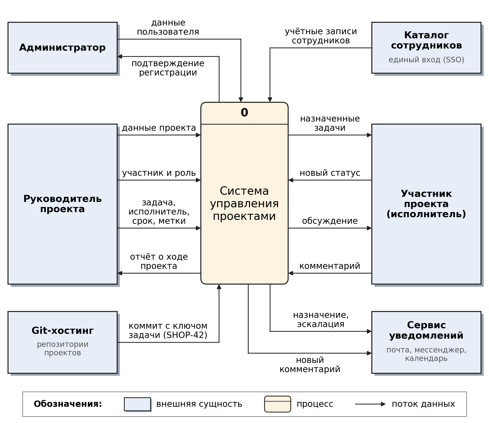

- **Отвечает на вопрос:** для чего система и где её граница.
- **Как читать:** в центре один процесс 0 — вся система целиком. Обойти внешние сущности по кругу и для каждой прочитать, что она даёт системе (стрелка к 0) и что получает (стрелка от 0). Например: руководитель отдаёт проекты, команды, задачи, параметры отчёта и получает перечни и отчёты.
- **На что обратить внимание:** шесть сущностей — три роли (администратор, руководитель, участник) и три сервиса (каталог сотрудников, Git-хостинг, сервис уведомлений). Потоков 16. Заказчика нет: данными с системой он не обменивается, отчёт ему доставляет сервис уведомлений.

### А.2 DFD уровня 1 (с. 64)

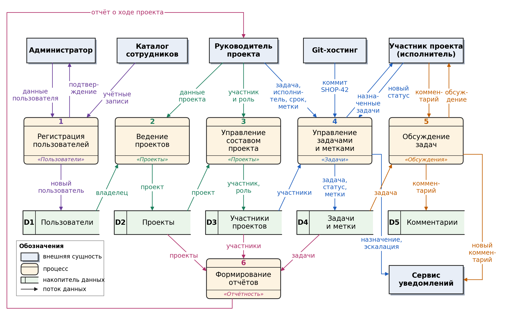

- **Отвечает на вопрос:** из каких процессов состоит система и какие данные у каждого.
- **Как читать:** сверху внешние сущности, посередине шесть процессов, под ними накопители D1–D12, внизу широкий процесс 6. Идти по столбцам: сущность → процесс → какие накопители он пишет → процесс 6 их читает. Курсив внизу процесса — подсистема («Пользователи», «Проекты», «Задачи»…).
- **На что обратить внимание:**
  - «один накопитель — одна таблица»: D1 = `users` … D12 = `comments`;
  - накопитель стоит между процессами, если один его пишет, а другой читает: D1 пишет процесс 1 («новый сотрудник»), читает процесс 2 («владелец»);
  - процесс 6 только читает — все стрелки к нему идут из накопителей;
  - петли по левому краю — «параметры отчёта» и «перечни и отчёты» руководителя, справа — «отчёт заказчику» в копию сервиса уведомлений;
  - **балансировка:** все 16 потоков А.1 есть и здесь, только теперь видно, какой процесс их принимает.

### А.3 Диаграмма декомпозиции функций (с. 65)

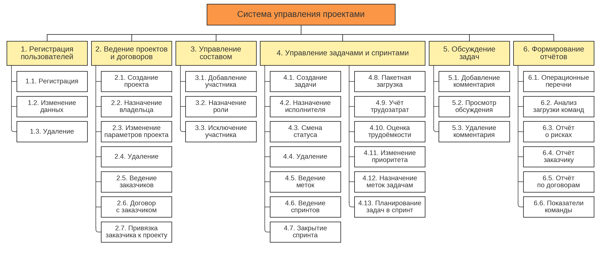

- **Отвечает на вопрос:** что система умеет делать — полный список функций, без данных и порядка действий.
- **Как читать:** сверху вниз. Корень — система; второй уровень — шесть функций, их номера и названия совпадают с процессами DFD уровня 1; под каждой — подфункции, ровно те же, что подпроцессы на DFD уровня 2; функция 4 нарисована в два столбца.
- **На что обратить внимание:** дерево и DFD описывают одно и то же с разных сторон. Дерево — состав действий («что делает»), DFD — движение данных между ними («с какими данными»). Всего 6 функций и 35 подфункций. Подфункция атомарна: один инициатор, один момент выполнения, одни правила и одни накопители (для процесса 6 — один вопрос руководителя). Номер — идентификатор, а не порядок: выделенные при разбиении части получили следующие номера (2.7, 4.10–4.13). На подфункции ссылаются сервисные задачи BPMN, операции компонентов и права в матрице доступа.

### А.4–А.9 DFD уровня 2 (с. 66–69)

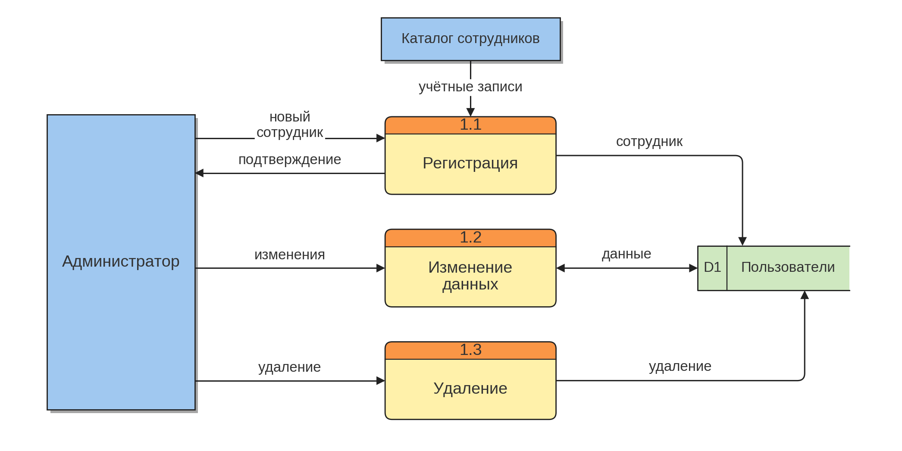

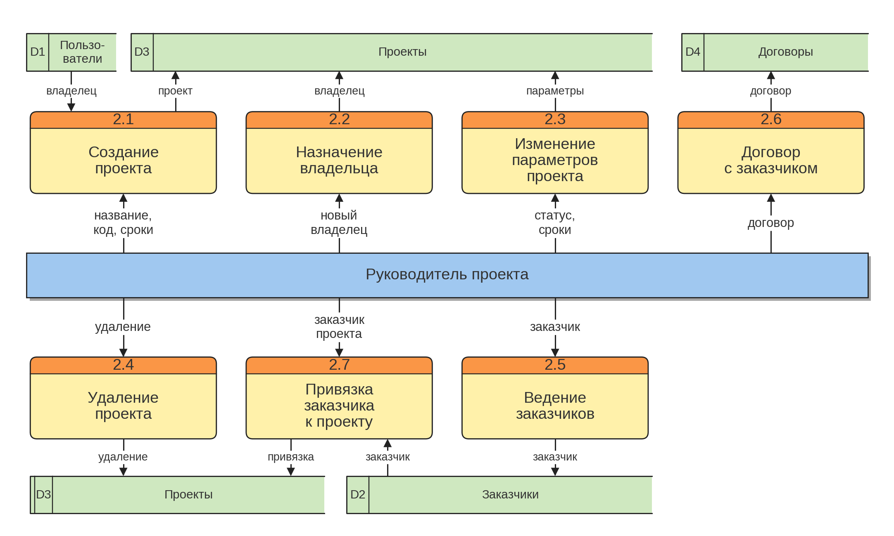

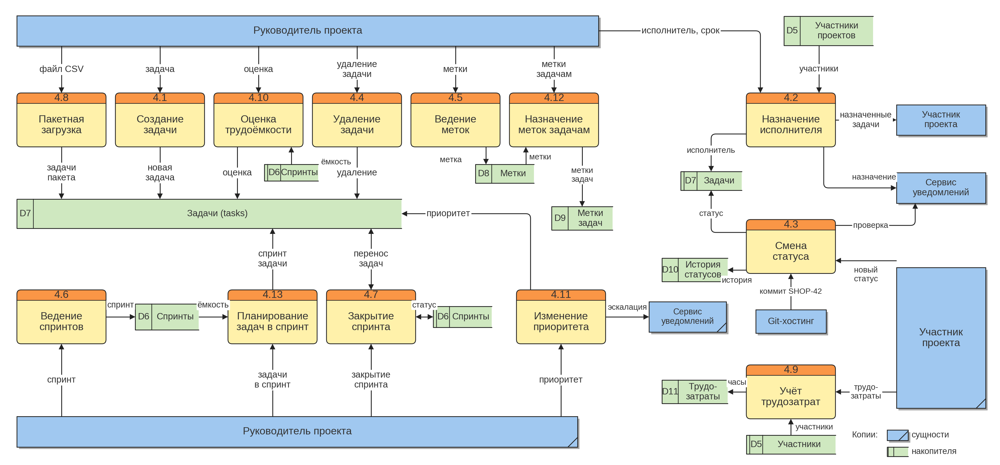

- **Отвечает на вопрос:** из каких элементарных действий (подпроцессов) состоит каждый процесс. Это функции системы: 35 штук.
- **Соответствие:** А.4 — процесс 1, А.5 — 2, А.6 — 3, А.7 — 4, А.8 — 5, А.9 — 6.
- **Три вида раскладки:**
  - процессы 1, 3, 5 (А.4, А.6, А.8): сущность слева, три подпроцесса столбцом, накопитель справа; сверху — то, что приходит извне (каталог сотрудников для 1.1, D3 «Проекты» для процесса 3, D7 «Задачи» и сервис уведомлений для процесса 5);
  - процессы 2 и 6 (А.5, А.9): руководитель — полоса посередине, подпроцессы над ней и под ней (у процесса 2 четыре сверху и три снизу), накопители — над верхним рядом и под нижним;
  - процесс 4 (А.7): тринадцать подпроцессов; сверху — те, что пишут задачи и метки, снизу — спринты и приоритет, справа — назначение, статус и трудозатраты; D7 «Задачи» — длинная полоса (плюс копия справа); D8 «Метки» и D9 «Метки задач» есть только здесь, потому что их использует только процесс 4.
- **Как проверить балансировку:** взять процесс на А.2 и сравнить его стрелки со стрелками, которые пересекают границу на его DFD-2. Поток можно разделить, но нельзя потерять. Пример: поток руководителя к процессу 4 «задачи (в т. ч. CSV), спринты» на А.7 разделён на одиннадцать потоков — файл CSV, задача, оценка, удаление, метки, метки задачам, исполнитель и срок, спринт, задачи в спринт, закрытие спринта, приоритет.

---

## Приложение Б. Модели данных

### Б.1 ER-диаграмма в нотации Чена (с. 70)

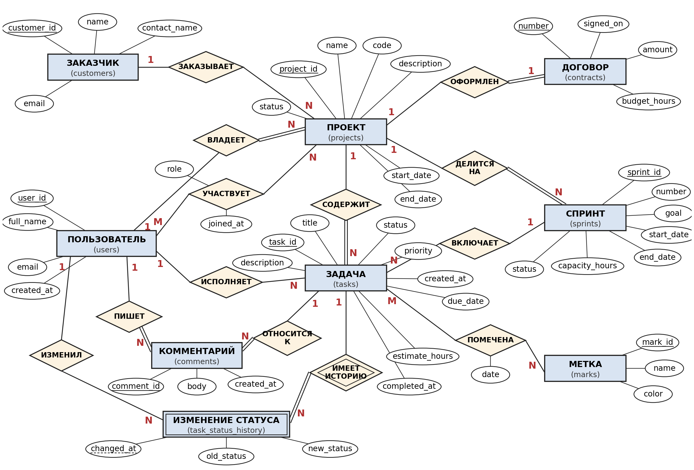

- **Отвечает на вопрос:** что существует в предметной области и как связано — без таблиц и SQL.
- **Фигуры:** прямоугольник — сущность (в скобках — будущая таблица), ромб — связь-глагол, овал — атрибут, подчёркнутый — ключ. Цифры у линий (1, N, M) — кардинальность. Двойная линия — обязательное (полное) участие.
- **Как читать:** начать с ПРОЕКТА в центре и читать каждую связь как предложение. «ЗАКАЗЧИК ЗАКАЗЫВАЕТ ПРОЕКТ, 1 : N» — у заказчика много проектов. «ПРОЕКТ ОФОРМЛЕН ДОГОВОРОМ, 1 : 1, у договора двойная линия» — договора без проекта не бывает. Затем перейти к ЗАДАЧЕ и ПОЛЬЗОВАТЕЛЮ.
- **На что обратить внимание:**
  - 10 сущностей и 15 связей (в тексте 1.4 сейчас написано «четырнадцать» — это ошибка);
  - овал у ромба — атрибут связи: `role` и `joined_at` у УЧАСТВУЕТ, `date` у ПОМЕЧЕНА;
  - ИЗМЕНЕНИЕ СТАТУСА — слабая сущность (двойная рамка): существует только вместе с задачей. Её связь ИМЕЕТ ИСТОРИЮ — идентифицирующая (двойной ромб), а `changed_at` подчёркнут пунктиром — это частичный ключ.

### Б.2 Модель системы оценивания качества (с. 70)

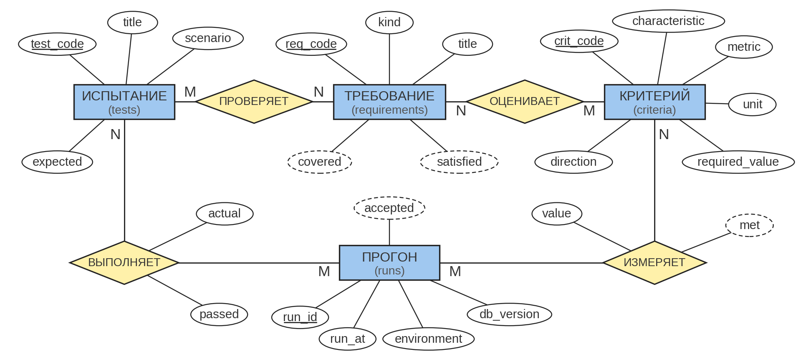

- **Отвечает на вопрос:** как хранятся требования, критерии и результаты испытаний.
- **Как читать:** верхний ряд — что проверяем: ИСПЫТАНИЕ ПРОВЕРЯЕТ ТРЕБОВАНИЕ, КРИТЕРИЙ ОЦЕНИВАЕТ ТРЕБОВАНИЕ. Это прослеживаемость, связи M : N. Нижний ряд — результаты: ПРОГОН ВЫПОЛНЯЕТ испытания (фактический результат `actual`, `passed`) и ИЗМЕРЯЕТ критерии (`value`).
- **На что обратить внимание:** пунктирные овалы — вычисляемые атрибуты, их считает запрос: `covered` (требование покрыто), `satisfied` (выполнено), `met` (критерий выполнен), `accepted` (прогон принят).

### Б.3 Логическая модель данных (с. 71)

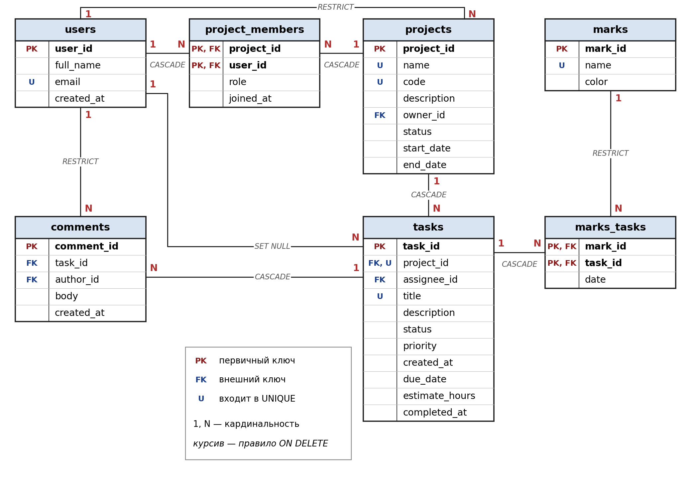

- **Отвечает на вопрос:** какие таблицы и столбцы получились из ER-модели и как таблицы связаны.
- **Как читать:** слева от столбца — PK, FK или U (входит в UNIQUE). Линия соединяет внешний ключ с таблицей, на которую он ссылается. Цифры 1 и N — кардинальность, курсив на линии — что происходит при удалении. Начать с `tasks` в центре.
- **Правила перевода:** сущность → таблица; 1 : N → внешний ключ на стороне N; M : N → отдельная таблица из двух ключей (`project_members`, `marks_tasks`); 1 : 1 → общий ключ (`contracts.project_id` — одновременно PK и FK).
- **Действия при удалении:**
  - CASCADE — удалить вместе: задачи, спринты и состав команды вместе с проектом; комментарии и история вместе с задачей;
  - RESTRICT — запретить удаление: нельзя потерять владельца, заказчика, договор, автора комментария, метку и автора трудозатрат;
  - SET NULL — обнулить ссылку: при исключении участника задача остаётся, но без исполнителя.

---

## Приложение В. Процессные модели BPMN

**Фигуры:**
- пул — большая рамка процесса; дорожки — полосы участников, нижняя серая дорожка — система;
- тонкий круг — начало, толстый — конец; круг с двойной рамкой на краю задачи — граничное событие;
- маркеры событий: конверт — сообщение, часы — таймер, молния — ошибка;
- скруглённый прямоугольник — задача: жёлтая с человечком делает человек, синяя с шестерёнкой делает система;
- ромб с крестом — исключающий шлюз («или-или»);
- сплошная стрелка — порядок действий;
- пунктир с кружком в начале — сообщение между пулами;
- пунктир к цилиндру — запись в хранилище, от цилиндра — чтение; цилиндр подписан номером накопителя DFD.

### В.1 Обзорная модель «Ведение проекта» (с. 72)

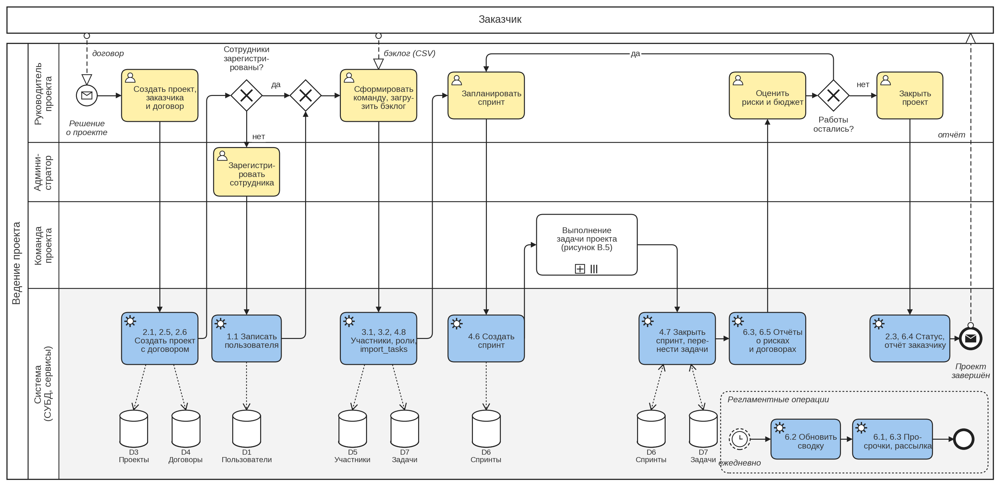

- **Отвечает на вопрос:** как процессы 1–6 складываются в жизнь проекта от договора до закрытия.
- **Как читать:** от конверта слева — договор пришёл от заказчика. Сплошные стрелки: создать проект → шлюз «Сотрудники зарегистрированы?» (нет — администратор регистрирует) → сформировать команду и загрузить бэклог → запланировать спринт → выполнение задач → закрыть спринт → отчёты о рисках и договорах → шлюз «Работы остались?». «Да» возвращает к планированию спринта — это цикл спринтов, «нет» ведёт к закрытию проекта и отчёту заказчику.
- **На что обратить внимание:**
  - заказчик — свёрнутый пул (пустая полоса сверху): что у него внутри, не моделируем, видны только сообщения — договор, бэклог, отчёт;
  - «Выполнение задачи проекта» — свёрнутый подпроцесс: «+» значит, что он раскрыт на отдельной схеме (В.5), три черты — что выполняется много экземпляров параллельно (много задач);
  - пунктирная рамка справа внизу — событийный подпроцесс: по таймеру «ежедневно» обновляется сводка, ищутся просрочки, рассылаются отчёты.

### В.5 «Выполнение задачи проекта» — процесс 4 (с. 75)

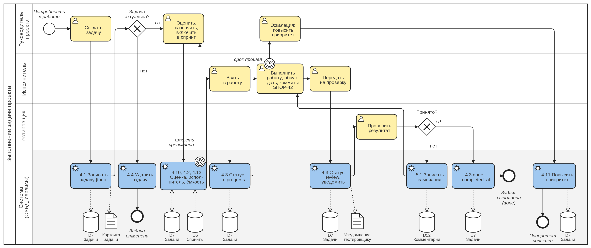

- **Отвечает на вопрос:** как одна задача проходит путь от появления до выполнения — главный процесс системы.
- **Как читать:** четыре дорожки — руководитель, исполнитель, тестировщик, система. Каждое действие человека вызывает синюю задачу системы под ним, номер синей задачи — номер подпроцесса DFD:
  - создать задачу → 4.1 записать (статус todo);
  - шлюз «Задача актуальна?»: нет — 4.4 удалить и конец «Задача отменена»;
  - да — руководитель оценивает, назначает и включает в спринт → 4.10, 4.2, 4.13: записать оценку и исполнителя, проверить ёмкость;
  - исполнитель берёт в работу → 4.3 in_progress → работает, обсуждает, делает коммиты → передаёт на проверку → 4.3 review и уведомление;
  - тестировщик проверяет → шлюз «Принято?»: нет — 5.1 записать замечания и вернуть исполнителю, да — 4.3 done и конец «Задача выполнена».
- **На что обратить внимание:**
  - молния на задаче 4.10, 4.2, 4.13 — ошибка «ёмкость превышена»: это триггер с кодом PM004, поток возвращается руководителю;
  - часы на задаче исполнителя (пунктирная рамка) — непрерывающий таймер «срок прошёл»: руководитель проводит эскалацию, система повышает приоритет (4.11), а работа продолжается;
  - листы с загнутым углом — электронные документы: карточка задачи, уведомления;
  - каждая синяя задача — одна операция с БД (`INSERT` или `UPDATE`).

### В.2–В.4, В.6, В.7 — процессы 1, 2, 3, 5, 6 (с. 73–76)

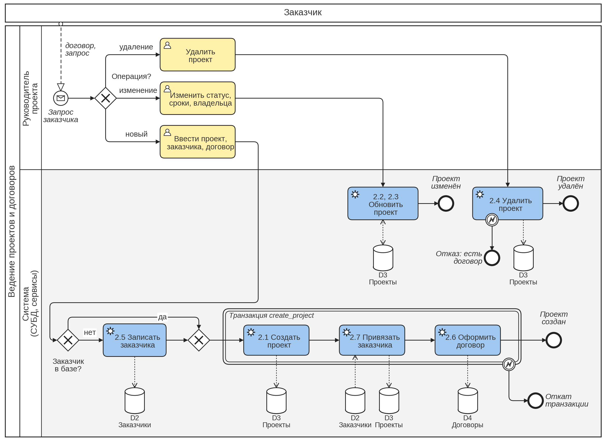

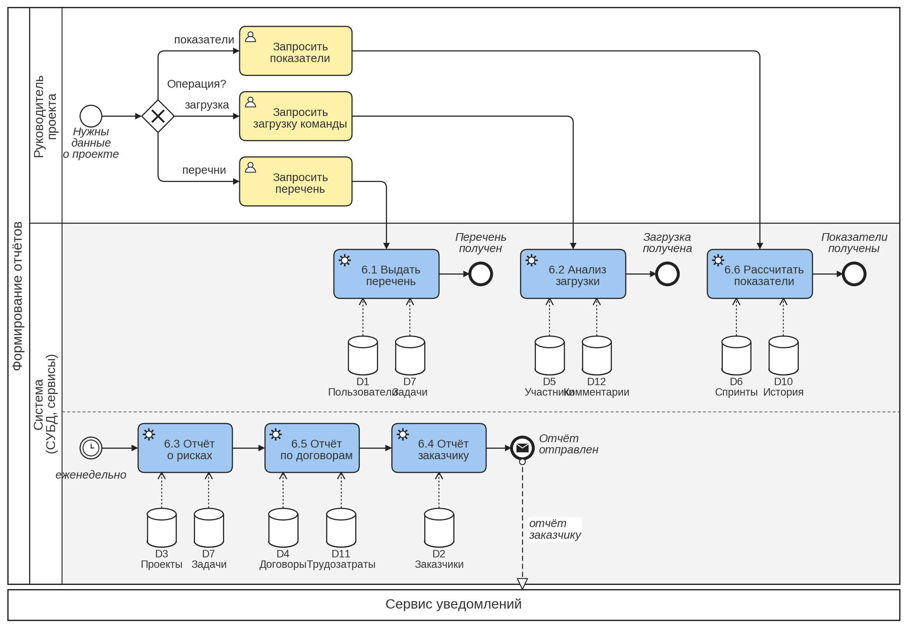

- **Отвечает на вопрос:** как выполняется каждая операция процесса и что бывает при нарушении правила.
- **Соответствие:** В.2 — процесс 1, В.3 — 2, В.4 — 3, В.6 — 5, В.7 — 6.
- **Как читать:** начало слева → шлюз «Операция?» → три ветки (например, приём, изменение, увольнение) → задача человека → вниз к синей задаче системы → конец; подпись конца стоит над ним. Под синей задачей — хранилища и, если есть, ошибка.
- **Почему ветки «лесенкой»:** верхняя ветка уходит правее всех, чтобы линии не пересекались. Ветки — альтернативы, а не последовательность во времени.
- **На что обратить внимание:**
  - каждая молния — реальное ограничение БД: в процессе 1 «почта занята» (UNIQUE) и «есть проекты, часы» (RESTRICT), в процессе 2 «есть договор» (RESTRICT), в процессе 3 «уже в команде» (первичный ключ), в процессе 5 «пустой текст» (CHECK);
  - в процессе 2 задача с двойной рамкой — транзакция: создание проекта с заказчиком и договором выполняется целиком или откатывается целиком;
  - свёрнутые пулы внешних участников: каталог сотрудников (процесс 1, сообщение в 1.1), заказчик (процесс 2, сообщение в начальное событие), сервис уведомлений (процессы 5 и 6, сообщение из конца с чёрным конвертом);
  - в процессе 6 ниже пунктирной линии — регламентная часть: таймер «еженедельно» → 6.3 → 6.5 → 6.4 → отчёт заказчику.

---

## Приложение Г. Схемы алгоритмов

### Г.1 Схема вычислений отчёта о рисках (с. 77)

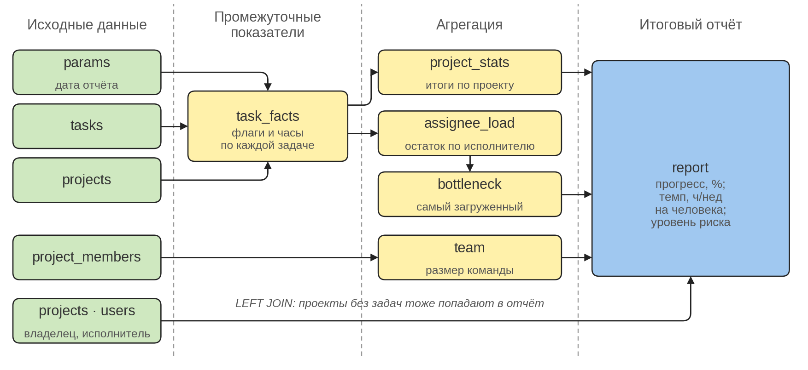

- **Отвечает на вопрос:** как из таблиц получается отчёт о рисках.
- **Как читать:** слева направо, как конвейер, по четырём столбцам: исходные данные (зелёные — таблицы и параметр «дата отчёта») → промежуточные показатели (`task_facts`: флаги и часы по каждой задаче) → агрегация (итоги по проекту, остаток по исполнителю, самый загруженный, размер команды) → итоговый отчёт. Каждый жёлтый блок — одно обобщённое табличное выражение (`WITH … AS`), стрелка показывает, какое выражение использует какое.
- **На что обратить внимание:** подпись внизу — LEFT JOIN, поэтому проект без задач тоже попадает в отчёт («нет задач»).

### Г.2 Схема алгоритма модуля 10 по ГОСТ 19.701 (с. 77)

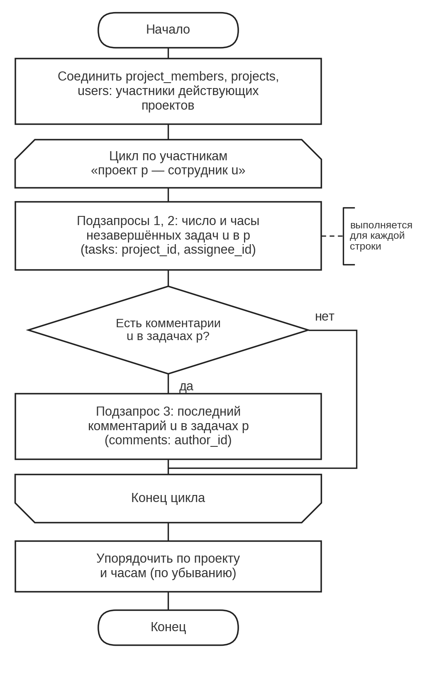

- **Отвечает на вопрос:** почему этот запрос самый медленный.
- **Фигуры:** овал — начало и конец, прямоугольник — действие, ромб — условие, шестиугольники со срезанными углами — начало и конец цикла, квадратная скобка с пунктиром — комментарий.
- **Как читать:** сверху вниз. Главное — подзапросы стоят внутри цикла по участникам, это и подчёркивает комментарий «выполняется для каждой строки». Без индекса каждый проход цикла просматривает всю таблицу, поэтому время растёт квадратично.
- **Если спросят про ромб:** «Есть комментарии?» — упрощение. SQL выполняет подзапрос всегда, ветка «нет» означает пустую дату последнего комментария.

---

## Приложение Д. Архитектура

### Д.1 Окружение системы (с. 78)

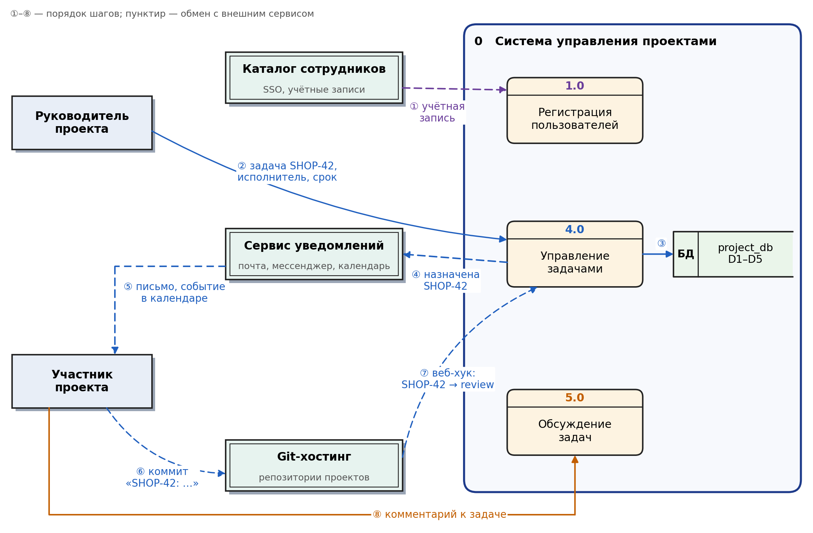

- **Отвечает на вопрос:** как система работает вместе с людьми и сервисами — на примере одной задачи.
- **Как читать:** по номерам шагов 1)–10). Большая серая рамка справа — система (процессы 1.0, 4.0, 5.0, 6.0 и БД), снаружи — люди и сервисы. Двойная рамка — внешний сервис, пунктир — обмен с внешним сервисом, серая стрелка «требования» — обмен вне системы (заказчик и руководитель).
- **Путь:** 1) каталог передаёт учётную запись → 2) руководитель создаёт задачу SHOP-42 → 3) запись в БД → 4–5) уведомление и письмо исполнителю → 6–7) коммит «SHOP-42: …» и веб-хук переводят задачу в review → 8) обсуждение → 9–10) еженедельный отчёт заказчику по почте.

### Д.2 Компоненты, информационный ресурс и окружение (с. 79)

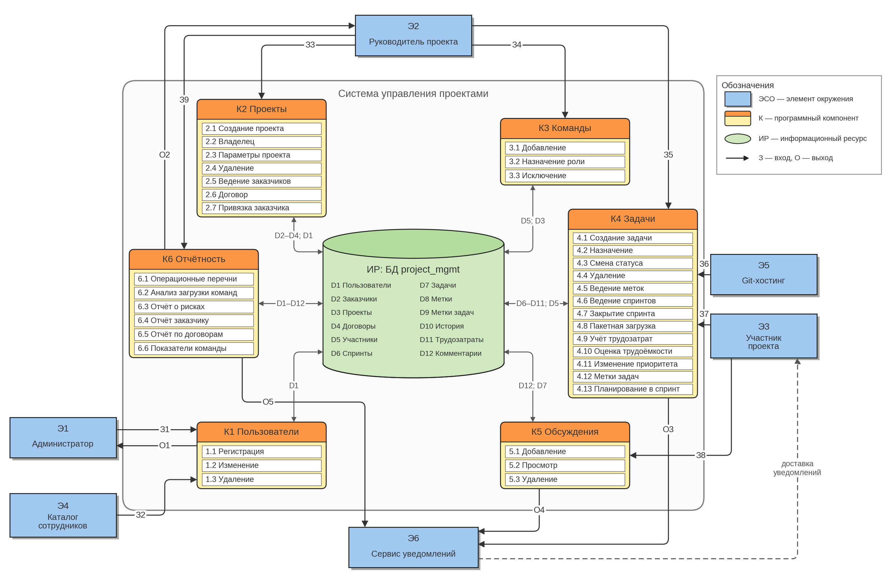

- **Отвечает на вопрос:** из каких программных частей состоит система и как они связаны с данными и окружением. Это главная схема архитектуры.
- **Как читать:** серая рамка — граница системы. Оранжевые блоки К1–К6 — компоненты, внутри — их операции с номерами подпроцессов DFD. Зелёный цилиндр в центре — информационный ресурс: БД со списком D1–D12. Снаружи — элементы окружения Э1–Э6.
- **Подписи у стрелок к БД:** до точки с запятой — свои накопители (компонент пишет), после — чужие (только читает). «D2–D4; D1» у К2 значит: пишет заказчиков, проекты и договоры, читает пользователей. К6 читает всё (D1–D12).
- **Стрелки к окружению:** «З» — вход в систему, «О» — выход (буква З похожа на цифру 3: «31» читается как «З1»). Содержание каждой связи — в таблице 12.

### Д.3 Контейнеры системы, модель C4 (с. 80)

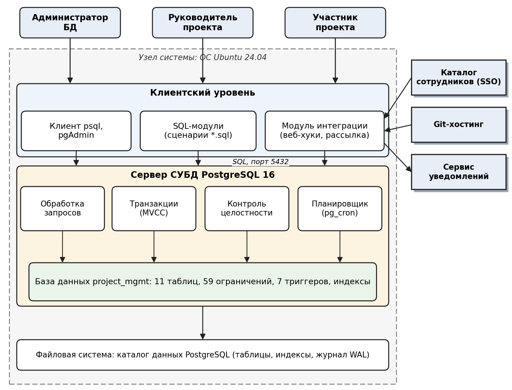

- **Отвечает на вопрос:** что физически запускается, на какой технологии и как части общаются.
- **Фигуры:** тёмно-синие — люди [Person], голубые — контейнеры системы с технологией в скобках, серые — внешние системы, пунктирная рамка — граница системы. На стрелке — действие и протокол.
- **Как читать:** от человека вниз до базы. Руководитель → веб-интерфейс (Streamlit) по HTTPS → REST API (FastAPI) по HTTP/JSON → база данных PostgreSQL по SQL под ролью `pm_app`. Модуль интеграции принимает веб-хуки Git, синхронизирует каталог и рассылает уведомления.
- **Чем отличается от Д.2:** Д.2 — логическое деление по функциям (К1–К6), Д.3 — физическое по запускаемым программам. Компоненты К1–К6 реализованы внутри REST API, модуля интеграции и базы.
